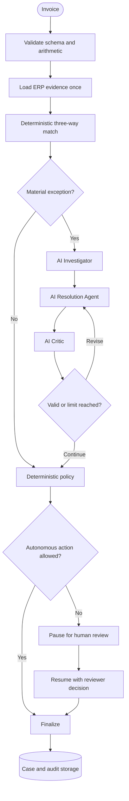

# Autonomous P2P Exception Handler

**AI recommends. Policy authorizes. Humans own material risk.**

This project is a working simulation of an invoice-exception control plane for Procure-to-Pay (P2P) operations.

At a high level, it validates an invoice, gathers the related purchase order and receipt data, runs a deterministic three-way match, and only calls an AI model when the case actually requires interpretation.

The goal is not to build a chatbot that pretends to be an accounts-payable team. It is to show how AI can fit into a controlled financial workflow where calculations, recommendations, policy decisions, reviews, and final outcomes are all traceable and have a clear owner.

> This is a portfolio demonstration, not a payment product. It cannot move money, write to an ERP, or contact a supplier.

## Why I built it

Invoice exceptions look straightforward until the underlying evidence starts to disagree.

A price mismatch, for example, could mean the supplier made a mistake. It could also mean the PO is outdated, the goods receipt was posted late, or a legitimate commercial change was agreed but never recorded.

That is why safely automating this kind of work takes more than putting an LLM behind a form.

I built this project around a simple separation of responsibilities:

* ordinary software establishes the financial facts;
* structured AI helps make sense of ambiguous evidence;
* deterministic policy decides what the system is allowed to do;
* a human takes over when a hard control or material-risk threshold is reached.

Keeping those responsibilities separate makes the workflow much easier to test, explain, and trust.

## How an invoice moves through the system

1. Pydantic models validate the invoice structure and arithmetic using `Decimal` values.
2. A local ERP repository loads the purchase order, goods receipts, supplier, and invoice history once.
3. The matcher checks for duplicates, required documents, supplier and currency consistency, line arithmetic, price differences, and quantity differences.
4. Exact matches and immaterial exceptions go straight to the policy engine without calling AI.
5. Material exceptions are passed through an Investigator, Resolution Agent, and Critic, each using validated structured outputs.
6. If the Critic finds the recommendation weak or unsupported, it can send it back to the Resolution Agent for revision. That loop is bounded by configuration.
7. Policy then either allows the outcome or pauses the workflow for human review.
8. The final decision, together with the full event history, is persisted and can be inspected in the UI.



## Where AI fits — and where it does not

| Responsibility                              | Owner                      |
| ------------------------------------------- | -------------------------- |
| Schema and invoice arithmetic               | Deterministic domain logic |
| PO, receipt, supplier, and duplicate lookup | Deterministic repository   |
| Price and quantity variance                 | Deterministic matcher      |
| Thresholds and action authorization         | Deterministic policy       |
| Root-cause synthesis                        | AI Investigator            |
| Proposed resolution or information request  | AI Resolution Agent        |
| Evidence and recommendation critique        | AI Critic                  |
| Protected decision                          | Human reviewer             |

Model confidence is treated as a risk signal, not as decision authority.

Low confidence can make the workflow more cautious, but high confidence can never override a hard financial rule. If the model returns invalid or malformed structured output, the system fails closed and routes the case to human review.

## A concrete demo path

A useful scenario to try from the dashboard is **large price variance**.

The first AI-generated proposal intentionally recommends an invalid approval. The Critic catches the problem and rejects the recommendation. The Resolution Agent then revises the action to `REQUEST_INFO`, after which policy pauses the case for human review.

Once the reviewer makes a decision, the same LangGraph thread resumes and the human decision is added to the audit timeline.

The exact-match scenario provides the opposite path. Because there is nothing ambiguous to interpret, the AI layer is never invoked, and the invoice can be approved autonomously when policy allows it.

## Architecture and repository map

* `src/p2p/domain` — financial models, matching, policy, and business rules. This layer has no LangGraph or infrastructure imports.
* `src/p2p/intelligence` — the model-provider boundary plus the Investigator, Resolver, and Critic services.
* `src/p2p/workflow` — typed LangGraph state, conditional routing, bounded reflection, and interrupt/resume behavior.
* `src/p2p/infrastructure` — SQLite repositories, checkpoints, audit events, and seeded ERP fixtures.
* `src/p2p/application` — process and resume use cases, kept independent of Streamlit.
* `src/p2p/ui/app.py` — the operations dashboard, including invoice ingestion, case detail, the review queue, and the audit timeline.
* `config/business_rules.yaml` — financial tolerances, risk thresholds, hard controls, and the reflection limit.
* `tests` — unit, integration, and end-to-end workflow coverage.

LangGraph is used because this problem benefits from explicit state transitions, a real Resolver → Critic loop, and a durable pause/resume boundary. The application keeps case snapshots for queries and reconciles them against durable checkpoints before returning case views. Reviewer submissions are journaled before resume; final decision audit events and snapshots commit together.

## Run locally

You need Python 3.11+ and [`uv`](https://docs.astral.sh/uv/).

```bash
cp .env.example .env
make setup
make seed
make run
```

Open <http://localhost:8501>. `make run` starts Streamlit headless, without usage statistics, and listens on `localhost` only; the dashboard has no login. To reach it from another machine, run `make run ADDRESS=0.0.0.0` (the Docker image always binds `0.0.0.0` inside the container, and Compose publishes it on loopback). The seed command inserts missing ERP fixtures and writes ten JSON invoice scenarios without deleting existing cases or audit history. Startup seeds only empty storage. `make setup` installs the frozen `uv.lock` resolution.

### Demo mode

`DEMO_MODE=true` is the default.

Demo mode still runs the real workflow graph, matching logic, policy engine, checkpointing, audit trail, and UI. The only mocked component is the model provider, which returns deterministic structured outputs.

That means the full workflow can be explored without an API key or any model network calls.

### Live-model mode

To use a live model, place credentials in `.env.local` or another ignored secret source:

```dotenv
DEMO_MODE=false
OPENAI_API_KEY=your-key-here
OPENAI_MODEL=gpt-4.1-mini
```

The live adapter uses the same typed provider interface and Pydantic response schemas as demo mode.

The timeout, retry and endpoint settings are listed under [Environment variables](#environment-variables).

Requests are sent with `store=False`. Each AI audit event records the model, response id, token counts and latency of the call.

When the model service cannot be reached (timeout, connection error, rate limit, server error, or an exhausted quota), the workflow stops asking the model, records the failure and sends the case to a reviewer; the reviewer sees "Model unavailable" and the reason. A rejected API key, or one without access to the configured model, is treated as a configuration fault instead: processing stops, the case stays recoverable, and the dashboard shows a setup screen. Starting with `DEMO_MODE=false` and no key shows the same screen. `P2P_DATABASE_URL` must not carry query options such as `?timeout=10`.

Never commit a real API key. `.env.local` is ignored by Git.

### Environment variables

Read from the process environment, then `.env.local`, then `.env` (an existing variable is never overridden by a file). An empty or whitespace-only `OPENAI_*` value counts as unset, so `OPENAI_BASE_URL=` copied from an example file calls OpenAI directly. Invalid values (a base URL without `http(s)://` and a host, a non-numeric timeout or retry count) show the setup screen with the fix instead of failing every call.

| Variable | Default | Effect |
|---|---|---|
| `DEMO_MODE` | `true` | `true` runs on the deterministic mock model; `false` calls OpenAI |
| `OPENAI_API_KEY` | unset | Required when `DEMO_MODE=false`; without it the dashboard shows the setup screen |
| `OPENAI_MODEL` | `gpt-4.1-mini` | Model used by the Investigator, Resolver and Critic |
| `OPENAI_BASE_URL` | unset (OpenAI itself) | Proxy or OpenAI-compatible endpoint; an `http(s)` URL with a host |
| `OPENAI_TIMEOUT_SECONDS` | `30` | Per-request timeout |
| `OPENAI_MAX_RETRIES` | `1` | SDK retries before a request counts as failed (an outage) |
| `P2P_DATABASE_URL` | `sqlite:///data/demo/p2p.db` | SQLite file for cases, audit events and checkpoints; must be a `sqlite:///` file path without query options |
| `P2P_RULES_PATH` | `config/business_rules.yaml` in the project | Business rules file |
| `P2P_REVIEWER_NAME` | `Demo Reviewer` | Name that signs human reviews; its initials appear in the top bar |
| `P2P_LOG_LEVEL` | `INFO` | Log level for the `p2p` loggers (standard error) |

## Run with Docker

```bash
docker compose up --build
```

The dashboard is available at <http://localhost:8501>. Compose binds the unauthenticated dashboard to host loopback only. The image does not copy local credential files.

- **Base images:** Python 3.11.18 (slim, Debian bookworm) and uv 0.11.29, both pinned by version and digest.
- **User:** the app runs as the unprivileged user `app` (uid 10001). Only `/app/data` is writable; it holds the database, checkpoints, WAL files and the command lock file.
- **Health:** a `HEALTHCHECK` polls Streamlit's `/_stcore/health`.
- **Data:** the named volume keeps cases and checkpoints across container restarts. A new volume takes its ownership from the image. A volume created by an older image that ran as root must be handed to the new user once:

  ```bash
  docker compose run --rm --user root p2p-handler chown -R 10001 /app/data/demo
  ```

## Before going live

1. **Smoke-test the live model.**

   ```bash
   export OPENAI_API_KEY=...   # in the shell, not only in .env.local
   make smoke-live
   ```

   **What it runs:** each of the ten demo invoices on its own new database, seeded exactly like the demo data, so every scenario starts with untouched purchase orders and reservations. The run tests the model, not collisions with earlier cases.

   **What it prints:**
   - At the top: the mode, the base URL host, and whether a proxy variable is set. Proxy values are not shown, since they can hold credentials.
   - Per invoice: Expected (what the mock provider produces for that scenario on a fresh seed), the live Status, Routed by (the policy rules that sent it to review, or `autonomous`), decision source, model, tokens, latency and any error.
   - A count of how many outcomes match Expected.

   **Result:**
   - **Pass:** it exits 0. A case sent to a reviewer because the model was unavailable is reported, not a failure; so is a model that reaches a different outcome from the mock.
   - **Fail:** it exits 1 on a rejected key, any unhandled exception, or when no model response was recorded in this run. Only responses received during this run count; a replayed case from your data does not.
   - **The key** is never printed.

   **Your own data:** `P2P_DATABASE_URL=sqlite:///path/to/your.db make smoke-live ARGS=--from-db` runs all ten on a copy of that database instead, under new invoice ids; the database must exist. It warns that existing cases keep their PO reservations, so results there can differ from Expected.
2. **Check the browser.** Open the app in Safari 16+ or Firefox 110+ as well as Chrome; the case detail layout uses CSS container queries.
3. **Hand old Docker volumes to the new user.** A volume created by an image from before 1.0.0, which ran as root, needs the one-time `chown` shown above.

## Test and lint

```bash
make test
make coverage  # tests with a coverage report; fails under the floor in pyproject.toml
make lint
make audit  # dependency advisory lookup; requires network
```

The test suite runs without network access. It covers financial validation, post-validation arithmetic corruption, matching scenarios, tolerance policy, duplicate protection, workflow routing, bounded reflection, malformed model output, model outages, SQLite adapters, durable interrupts, human resume behavior, and two OS processes sharing one database. GitHub Actions runs lint, format check and tests with coverage on every supported Python version (3.11 to 3.14), the dependency audit, and a job that builds the Docker image, starts it and waits for its health check. Audit regression coverage includes hostile typed model output, fractional thresholds, concurrent ingestion/review, save failures, restart recovery and post-review UI navigation. See [audit remediation and recovery](docs/audit-remediation.md).

## Included scenarios

| Scenario                     | Expected control behavior                      |
| ---------------------------- | ---------------------------------------------- |
| Exact match                  | Autonomous approval                            |
| Small price variance         | Approval inside the configured dual tolerance  |
| Large price variance         | Investigate → critique → revise → human review |
| Quantity variance            | Investigate and review                         |
| Quantity exceeds receipt     | Hard-control review                            |
| Missing PO                   | Never auto-approve                             |
| Missing goods receipt        | Request evidence and review                    |
| Duplicate invoice            | Deterministic rejection                        |
| Supplier mismatch            | Hard-control review                            |
| Exact but high-value invoice | Value-threshold review                         |

Each scenario's expected route assumes fresh storage. Processing an identical invoice again returns its original case. Different invoices sharing the same PO consume the same remaining capacity, so running multiple scenarios together can intentionally change later routes.

## Financial and evidence rules

Autonomous approval requires a deterministic match, an active matching supplier, an OPEN PO, sufficient remaining ordered/received quantities, and no unresolved model failure. Only known non-material price discrepancies may pass the final allowlist. Duplicate identities from seeded history are rejected; newly submitted identities are claimed atomically and replayed idempotently.

Pending and failed cases reserve quantities. APPROVE and terminal REQUEST_INFO retain reservations; REJECT releases them. Partial invoices outside the receipt tolerance require a reviewer. The quantity tolerance applies to receipt variance, while the PO order limit is strict. CLOSED, cancelled and unknown PO states require review. Supplier `risk_rating` is display-only; supplier existence and `active` are enforced.

Threshold comparisons retain Decimal precision. Monetary totals use two decimal places with ROUND_HALF_EVEN; this demo does not implement per-currency precision or tax policy. Investigator evidence must copy supplied matcher records exactly, and all recommendation references must resolve to them. Model narratives remain interpretations, not verified amendments or receipts. Critic confidence adjustments can only reduce effective confidence.

## Configuration

Operational thresholds live in [`config/business_rules.yaml`](config/business_rules.yaml).

Duplicate rejection and missing-document review switches must remain true; startup rejects unsafe combinations.

This includes price and quantity tolerances, confidence gates, high-value review rules, duplicate handling, missing-document controls, the reflection limit, and the review target (`review.sla_hours`, default 24) drawn on the Overview's waiting chart.

Financial thresholds are deliberately kept out of prompts.

For local runs, the rules file is resolved from the project directory. Packaged deployments can use `P2P_RULES_PATH`, avoiding any dependency on the Python installation path.

The dashboard has no login. Reviews are signed with the name in `P2P_REVIEWER_NAME` (default `Demo Reviewer`), and its initials appear in the top bar.

The case table stores a queryable summary of each case (supplier, amount, primary exception, AI recommendation, outcome and key timestamps) next to the full payloads. Opening a database created before these columns existed adds them and backfills existing cases from their payloads and audit events; the step runs once and is safe to repeat.

`P2P_DATABASE_URL` must be a `sqlite:///` file path. The database runs in WAL mode, so pages keep loading while a case is being processed; a case that is mid-run shows as "Processing" until the run finishes. When a run fails, the error is stored on the case, which shows as "Needs recovery" with the error under "Technical details" and a "Retry processing" button that resumes it from its last saved step.

Logs go to standard error at the level in `P2P_LOG_LEVEL` (default `INFO`): the start, outcome and duration of every processing and review run, and every model failure.

## Project scope

This repository is an end-to-end engineering prototype focused on one problem: making AI-assisted invoice exception handling controlled, explainable, and auditable.

To keep the project self-contained and easy to evaluate, I made a few deliberate scope choices:

* ERP data is synthetic and accessed through repository adapters. The application cannot post transactions or move money.
* Invoice ingestion uses structured JSON, keeping OCR and PDF extraction separate from the decision workflow.
* The dashboard is intended for a local, single-user demonstration, so authentication and role management are outside the current scope.
* SQLite provides durable local case storage and LangGraph checkpoints, while the persistence interfaces are designed so they can be replaced in a distributed deployment.
* Deterministic mock responses make the complete workflow reproducible without an API key. A live-model adapter is also available, while offline tests focus on orchestration and policy behavior rather than provider-specific quality, latency, or cost.

The controls are verified within this local simulation. They do not establish production ERP provenance, distributed transaction guarantees, or live-model reliability. See the recovery contract and limitations in the remediation report.

## Production-readiness roadmap

A production pilot could extend the same architecture in three stages.

### 1. Identity and durable controls

Add authenticated users, maker-checker roles, Postgres-backed application and checkpoint storage, and immutable external audit retention.

### 2. Enterprise evidence integration

Connect read-only ERP sources and add invoice-document extraction with field-level provenance and confidence.

### 3. Operational assurance

Add approved supplier communication channels, entity- and jurisdiction-specific policies, distributed tracing, evaluation datasets, and monitoring for live-model quality, latency, and cost.

The next portfolio milestones are a public read-only deployment using synthetic data, a concise product walkthrough, and an evaluation report covering routing accuracy, failure modes, and policy outcomes.

## Engineering capabilities demonstrated

* Designed domain-driven boundaries that keep probabilistic reasoning separate from financial decision authority.
* Implemented deterministic three-way matching, configurable policy controls, and explainable risk routing.
* Built a stateful LangGraph workflow with typed state, bounded reflection, durable interrupts, and human resume.
* Enforced structured model outputs using Pydantic validation and fail-closed behavior.
* Created auditable case histories using adapter-based repositories and persistent checkpoints.
* Built a responsive operations dashboard for ingestion, case inspection, review, and audit exploration.
* Added reproducible seeded scenarios, offline unit and integration tests, Docker packaging, and GitHub Actions CI.
